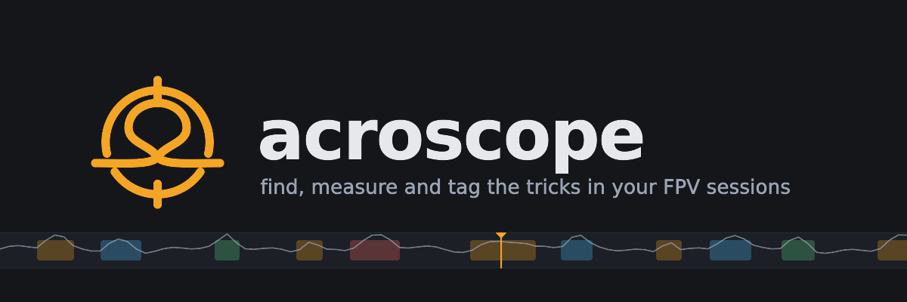
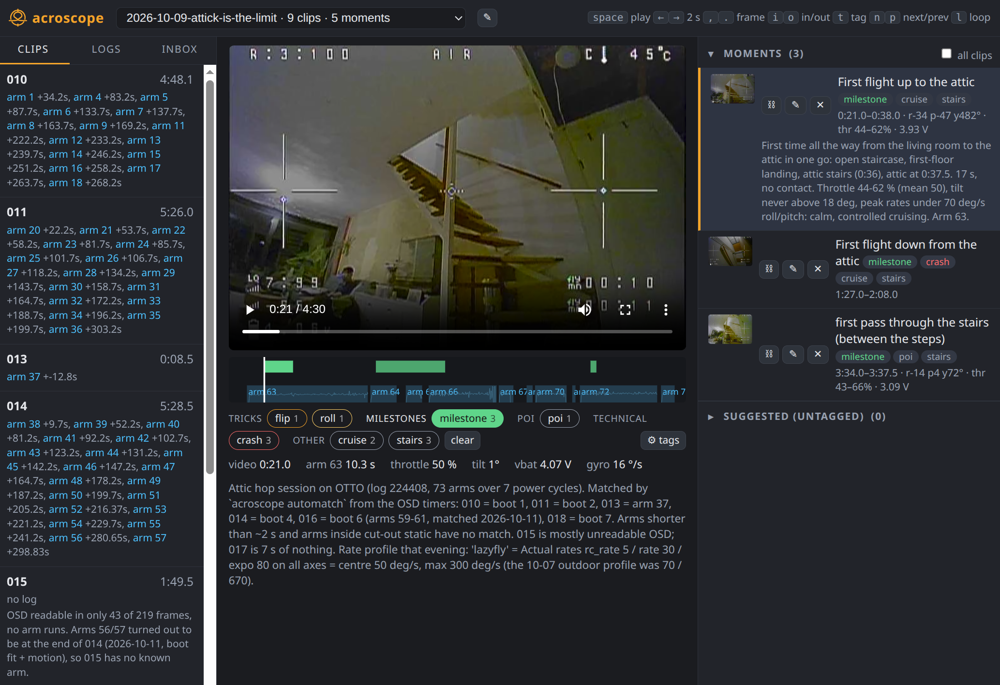

# acroscope

A trick-learning tool for FPV: find the tricks (flips, rolls, powerloops, split-S, dives, orbits) and the crashes in
a flying session, measure each attempt from the blackbox, tag the moments in the DVR footage, and let an AI agent
coach from the numbers and the frames.

Two users over one data layer:

- the **person** uses the player (`acroscope serve`): tagged playback, tagging with in/out points, suggestions
- the **agent** (Claude Code) uses the CLI: sessions, arms, metrics, events, frames, tag


*The player on the 2026-10-09 attic session, at the start of the moment "First flight up to the attic" (clip 018,
0:21, the milestone tag picked): the clips with the arms automatch placed in them, the log strip under the video (arm
63 at the cursor), the readout at the current frame, the tag bar, and the three milestone moments with their
numbers.*

The logs tab lists a session's logs by power cycle, each arm with the clip that covers it. On top, 🎯 runs automatch
on the session's clips without a match (a log that came after its clips; matches made by hand are left alone). On each
log: ⤓ downloads the .bbl (for Blackbox Explorer), ⇄ moves it to another session, 🗑 takes it out of this one (its
matches here are deleted, the file stays). A log taken out of a session stays out: the refresh attaches a session's
same-date logs only when it has none, and never one taken out by hand.

The blackbox is a supporting layer: it shows which flights the clips cover and feeds the metrics. Deep log reading
stays in the Betaflight App's blackbox viewer.

## Data layout

The data dir (`ACROSCOPE_DATA`; on the server a bind mount of the homelab's `Data/fpv` dataset) holds the footage,
the logs, and what arrives:

```
videos/<YYYY-MM-DD[-session]>/<id>.mp4       clips: H.264, no-signal stretches cut; the file name is the clip's id,
                                             its readable name (<date>_NNN) is in the database (older clips still
                                             carry that name as the file name)
blackbox/*.bbl                               full flash dumps, many arms per file
inbox/<batch>/                               what the laptop drops: VID*.mov off the card, *.bbl off a quad, an optional
                                             import.json ({date, session, imported_at, host}) and a .done marker written
                                             last (optionally a manifest {"files": {name: size}}); consumed by ingest
originals/<session>/<id>.mov                 the originals, kept 7 days after the compressed clip verified
originals/.ingest/<batch>/                   a batch's clips taken out of the inbox and their encodes, until each is in place
                                             (what a crashed ingest left there, the retry finishes)
state/acroscope-<date>.db                    nightly copies of the database (seven kept)
```

**Ingest** (`acroscope/ingest.py`, the server runs it on complete batches, one at a time): the date and session from
the sidecar (else the import time; `<date>-unsorted` when unnamed), the clips numbered `<date>_NNN` continuing the
day's sequence over all its sessions in card order, each compressed (no-signal runs of 5 s or more cut with 1 s of
padding: static is a flat frame that changes like noise, while a flat still picture such as dusk or a grey sky is
kept; libx264 crf 23, keyframe every 0.5 s) and verified against the kept stretches, re-timed when the OSD's arm
clock runs more than 5 % off the clip's, evenly through the clip, in the original's time (a DVR that wrote ~27 fps
stamped 60: timestamps scaled, audio dropped, the factor kept as the clip's `timescale`; a cut inside an arm or one
DVR stall is not a fast clock, and a clip whose OSD cannot be read stays as it is), the logs moved to
`blackbox/` and attached to the session, the arms decoded, automatch run on the new clips (and, when the batch brought
a log, on the session's clips without a match: a log may come after its clips). A failed batch stays in `inbox/`
with its error shown; a retry does not import a clip twice.

Everything acroscope knows about a session (its clips with duration and codec, its blackbox files, the matches
video <-> arm + offset, the moments, the notes) is in one SQLite database (`ACROSCOPE_DB`, default
`~/.local/share/acroscope/acroscope.db`), owned by the server. The server walks the data dir in the background (at
start, every 5 minutes, and on `refresh`): new session folders and clips are registered, a clip whose file is gone
is marked `missing_since` and keeps its matches and moments until an explicit `purge`. A folder that cannot be
listed, or lists no clip at all, marks nothing, so an unmounted or half-synced Drive never looks like a deletion.

A CLI on another machine does not open the database: set `ACROSCOPE_URL=http://<server>:8070` (or put it in
`~/.config/acroscope/url`) and it uses the server's API for everything in the database, and the commands that need
the clips, the logs or the cache (`arms`, `decode`, `metrics`, `events`, `frame`, `sheet`, `osd`, `automatch`,
`match`, `attach`, `detach`, `tag`, `sessions`, `inbox`) run on the server; frames and sheets come back as files
into the local cache; such a command runs as a job on the server that the client polls (`POST /api/cli` with
`async`, `GET /api/cli/<job>`), so a long one (automatch over a whole session) hits no read timeout. Nothing on that machine needs the data dir. The pre-database `videos/<session>/session.json` files are imported once by
`acroscope import-json` (a server with an empty database does it at start) and not read afterwards.

The cache (`ACROSCOPE_CACHE`, default `~/.cache/acroscope`) holds decoded arms (`arms/<bbl>/arm-NN.bin` plus
`arms.json`), extracted frames, ffprobe results, OSD readings and H.264 proxies. Delete it any time.

`video time = arm time + offset`. The clips have static cut out, so an offset only holds within one arm; a clip can
have several matches.

## Install

```
python3 -m venv .venv && .venv/bin/pip install -e .     # needs ffmpeg/ffprobe on the PATH
.venv/bin/acroscope --help
```

Tests: `.venv/bin/python -m unittest discover tests` (the database, the API against a server child, ingest on a
synthetic batch, the aligner, the real-data pins through a server when one is configured). The player's
end-to-end tests run in a headless Chromium and skip until `scripts/browser-setup.sh` has run once (Playwright as the
`e2e` extra, the browser and the libraries it needs under `~/.cache`, no root).

`pip install orangebox` ends with an "Invalid script entry point: bb2csv" error from orangebox 0.5.0's wheel;
the package is installed anyway (the Dockerfile tolerates it and checks the import).

The data dir on joan (`~/gdrive/fpv`) was Rudi's Drive folder and stops being updated with the move; the CLI there
works through the server (`ACROSCOPE_URL`).

## Deployment

The homelab runs it as the Komodo stack `acroscope` (one container from `Dockerfile` + `compose.yaml`: `acroscope
serve` over CT 109's bind mount of the `Data/fpv` dataset, szrudi/homelab#102), reachable at
`acroscope.hakhorst.eu`. The live database is on the host in
`/opt/acroscope/state`; a nightly copy lands in the data dir's `state/`, so clips and index restore from one
snapshot. Hosting notes live in the homelab repo, `services/acroscope.md`.

## CLI (the agent side)

```
acroscope sessions [session]                     list sessions / show one: clips, arms with coverage, moments
acroscope scan                                   register every session folder (the server does it every 5 min)
acroscope refresh <session>                      the folder's clips in (durations, codecs), gone clips marked missing, bbl by date
acroscope purge <session> [clip] [--days N --yes]   remove clips marked missing, with their matches and moments
acroscope note <session> "<text>" [--clip NNN]   session or clip note
acroscope attach|detach <session> <bbl>          a blackbox file dated another day (detach drops its matches there)
acroscope import-json [session]                  one-off: the pre-database session.json files
acroscope session rename|date|move|merge|delete  rename a session (the date is its first ten characters), change its date,
                                                 move a clip to another session, merge one session into another, delete
                                                 a clip (the file into trash/<date>/ for 7 days, its rows gone)
acroscope inbox                                  the batches in inbox/ and their status
acroscope ingest [batch...]                      consume batches now (the server does it on its own)
acroscope recut <session> <clip>                 compress a clip again from its kept original (a cut that took real
                                                 footage, or a mis-stamped frame rate); moments and matches move with
                                                 it, a match across an old cut or on a changed clock is listed under
                                                 `check`
acroscope housekeeping                           originals past retention go, trash/ days older than 7 go; the database
                                                 is backed up into state/
acroscope arms <bbl>                             list the arms (decodes the whole file into the cache once, ~30 s)
acroscope decode <bbl> <arm> [--csv]             cache one arm; --csv dumps it like blackbox_decode for the old scripts
acroscope match <session> <video> <bbl> <arm> <offset>   record a video <-> arm match
acroscope metrics <session> <video> <from> <to> [--profile [STEP]] [--loop] [--orbit]
acroscope metrics --arm <bbl>:<n> <from> <to>    same, in arm seconds without a session
acroscope events <session> [video]               detector suggestions (flip, roll, powerloop, split-s, dive, crash, gyro-kick, motor-loss)
acroscope frame <session> <video> <t>... [--osd] JPEGs of frames; --osd enlarges the OSD strip (arm timer, total, vbat)
acroscope sheet <session> <video> <t>... | --from --to --every   one JPEG tiling several timestamped frames (one look for the agent)
acroscope tag <session> <video> <from> <to> "<title>" [--tags flip,crash] [--note ...] [--metrics] [--id mNN]
acroscope untag <session> <id>
acroscope moments <session>
acroscope automatch <session> [clips...] [--write] [--unmatched]   match clips to arms from the OSD timers (see below);
                                                 --unmatched: only clips without a match (the player's 🎯 in the logs tab)
acroscope osd <session> <clip>                   the timer readings and arm runs of a clip
acroscope transcode <session> [clips...] [--replace]   H.264 proxies in the cache, or replace the clips in place
acroscope serve [--port 8070]
```

Sessions and clips accept unique fragments: `acroscope events 10-07 007`. Times are seconds or `m:ss.s`.
`acroscope --version` says which store the CLI is using (the local database, or the server from `ACROSCOPE_URL`).

### API

What the player and the remote CLI use, JSON over HTTP on the server:

```
GET  /api/sessions                      the session list (counts of clips, missing clips, matches, moments)
GET  /api/session/<s>                   the session plus its arms (from the cache) and coverage
GET  /api/session/<s>/data              the session as stored: videos, blackbox, matches, moments
GET  /api/session/<s>/events?video=     detector suggestions for a clip
GET  /api/session/<s>/series?video=     throttle/tilt/vbat/gyro lanes per arm for the strip
GET  /api/session/<s>/sticks?video=     the sticks every 20 ms per arm (Mode 2, + = right/up, %) for the overlay
GET  /api/session/<s>/metrics?video=&from=&to=
POST /api/session/<s>/moment            {id?, video, start, end, title, tags, note, metrics?}   DELETE /api/session/<s>/moment/<id>
POST /api/session/<s>/match             {video, bbl, arm, offset, note}                        DELETE /api/session/<s>/match?video=&arm=
POST /api/session/<s>/note              {note, video?}
POST /api/session/<s>/blackbox          {add: [...], remove: [...]}
POST /api/session/<s>/refresh           {probe?}      walks the folder, returns the session
POST /api/session/<s>/purge             {video?, days?}
POST /api/session/<s>/rename            {name}        POST /api/session/<s>/date   {date}
POST /api/session/<s>/move              {video, to}   POST /api/session/<s>/merge  {into}
DELETE /api/session/<s>/clip?video=     the clip into trash/<date>/<s>/, its matches and moments gone
GET  /api/inbox                         batches and their status    POST /api/inbox/<batch>/retry
POST /api/scan   POST /api/import       GET /api/store
```

### Matching clips to arms

`acroscope automatch <session> [clips] --write` does it from the footage: it reads the two OSD timers (time since
arming, total armed time) at 2 fps with digit templates learned from labelled frames, turns the timer runs into arm
starts in video time, and aligns them to the log's arms by length and by the total counter against the boot's
cumulative length. Offsets come out within about half a second, and the method carries across the static stretches
`cobra-compress.py` cuts out. Arms shorter than about 2 s and arms whose timer never shows up readable stay
unmatched, as do clips without the OSD.

A clip it cannot read (no log covers it, a clip still syncing) is named on stderr, and with `--json` in `errors`
next to `results` (without errors the output is one clip's result, or the list, as it always was). The exit code is
1 when a clip named on the command line failed, or when a run over a whole session read no clip at all; a session
run where some clips have no log still exits 0.

What a clip may match is bounded by the other clips: an arm matched to another clip (in any session the log is
attached to) is taken, and clips are chronological, so a clip's arms lie after the arms of the clips named before it
and before those of the clips named after it (a run over a whole session carries its proposals from clip to clip
without `--write`). Within a clip the matches keep the log's order. A boot's line (video = a · uptime + b) that
needs more than 1 % clock difference, or two offsets further apart than the timer jitter, explains no clock: it
places and derives nothing, and the output says to check that boot's matches by hand. These matter most on the
cumulative-timer OSD, where a run's length is nearly all there is to go on.

A log that ended with the flash full (its last arm is cut off, `truncated` in `arms --json`) ends where the footage
says so: after each run the reader looks at the STATS screen Betaflight shows on disarm (TOTAL ARM, the armed time
on the pack, and BLACKBOX, how full the flash is). From the first run whose STATS shows BLACKBOX 100 %, in this clip
or an earlier one of the session after the log's last matched clip, nothing is in that log, and that run itself can
only be the cut-off last arm. `acroscope osd` lists the STATS reading after each run. The STATS geometry is per
layout (the rows move with the number of stats on); the bold-font layouts have none yet.

By hand, when needed: `acroscope arms <bbl>` lists the arms and the **boots** (power cycles; the log's time field is
the FC uptime, so one offset covers every arm of a boot). Read one frame per boot with `acroscope frame ... --osd`,
record `acroscope match <session> <clip> <bbl> <arm> <offset> --boot`, and refine on a sharp event: an impact in
`acroscope events`, or the STATS screen the OSD shows right after a disarm (its TOTAL ARM equals the arm length).
`acroscope unmatch` removes matches. The OSD seconds are floor values, so a single frame gives ±1 s.

The digit templates live in `acroscope/static/osd-templates.json`; `acroscope osd-learn scripts/osd-labels.json`
rebuilds them when the OSD font or layout changes (label a few frames by eye first, and label the exact frame the
reader sees: `acroscope osd` and the ASCII dumps in the labels workflow, not a JPEG from another extraction).

## Player

`acroscope serve` on the box that holds the data; open `http://<host>:8070/` in Chrome. Pick a session, pick a clip,
play. Keys: space, arrows (2 s, shift 10 s), `,` `.` (frame), `i` `o` (in/out), `t` (tag from in/out), `n` `p`
(next/previous moment), `l` (loop the current moment), `s` (virtual sticks on/off). The strip under the video shows
the moments, the suggested untagged events (hollow), the arm coverage and the throttle. The readout shows arm time,
throttle, tilt and vbat at the playhead. Over the picture, where a log covers it, the virtual sticks show the log's
sticks (Mode 2: throttle and yaw left, pitch and roll right), each dragging its last 0.8 s behind it.

Chrome on Linux has no HEVC decoder: clips before the H.264 switch need `acroscope transcode <session>` (proxies in
the cache; `--replace` rewrites the files in the data dir).

## Units and conventions (from the log)

Every `metrics` result carries a `conventions` block with these facts, so they never need re-deriving.

`gyroADC`/`gyroUnfilt` in deg/s; `rcCommand[0..2]` ±500 = ±100 % stick, `rcCommand[3]` 1000–2000; `vbatLatest` in
0.01 V; `accSmooth` /2048 = g; `imuQuaternion` /32767. Roll + = right, pitch + = nose down, yaw + = nose left (stick
and gyro alike; checked against the picture on 10-10 001 and 005); a back flip or a powerloop integrates to a
negative pitch angle. The firmware's `flightModeFlags` labels are wrong (shows ANGLE while the OSD shows AIR).

## Brand

The mark (a powerloop seen through a scope), the wordmark, the favicon, the app icon and the banner above live in
`acroscope/static/brand/`. `BRAND.md` there has the concept, the palette, usage notes and the commands that
regenerate the PNGs; `scripts/brand.py` generates the geometry.
